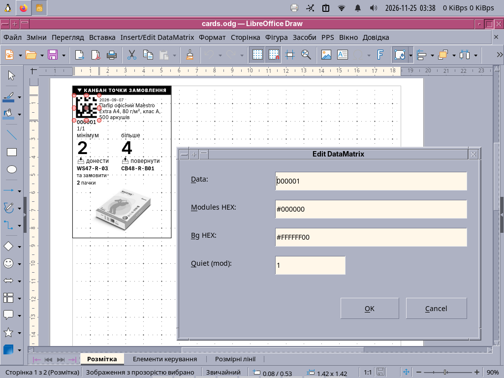

# DataMatrix Generator for LibreOffice

A lightweight, self-contained LibreOffice extension (`com.slovjinika.libreoffice.datamatrix`) that generates and inserts borderless, transparent-background **DataMatrix (ECC200)** barcodes directly into **Writer**, **Calc**, and **Draw**.

🖨️ [A4 sticker sheet generator](https://github.com/slovjinika/QR2A4)

## Features

* **Self-Contained ECC200 Encoder:** Built-in pure Python Reed-Solomon and ECC200 placement engine—no external CLI tools (`dmtxwrite`) or C-libraries (`libdmtx`) required.
* **Borderless & Transparent:** Renders crisp PNG barcodes with a transparent background (`RGBA`) and a minimal 1-module quiet zone so they blend seamlessly over colored backgrounds or text.
* **Smart Density Packing:** Automatically uses ECC200 ASCII 2-digit packing to select the smallest possible square symbol (e.g., `10×10` for short numeric strings).
* **Minimalist Workflow:** Integrates directly into the **Insert** menu (**Insert → Insert/Edit DataMatrix**) and toolbar with a single-field input dialog.
* **In-Place Editing:** Select an existing DataMatrix barcode in your document and run the command again to edit its encoded text while preserving its current dimensions.

## Requirements

* **LibreOffice** 7.0 or newer (Writer, Calc, or Draw)
* **Pillow (`PIL`)** available in LibreOffice's Python environment (pre-installed on most Linux distributions; on Windows/macOS, ensure `Pillow` is installed in the bundled Python if not already present)

## Installation

### Option 1: Via Extension Manager (GUI)

1. Download the latest `slovjinika-datamatrix.oxt` from the [releases](https://github.com/slovjinika/DataMatrixPlugin/releases/) page.
2. Open LibreOffice and go to **Tools → Extension Manager...** (`Ctrl+Alt+E`).
3. Click **Add...**, select `slovjinika-datamatrix.oxt`, and accept the license.
4. Restart LibreOffice.

### Option 2: Via Command Line (`unopkg`)

```bash
unopkg add slovjinika-datamatrix.oxt

```

## Usage

1. Open a document in **Writer**, **Calc**, or **Draw**.
2. Go to **Insert → Insert/Edit DataMatrix** (or click the **Insert/Edit DataMatrix** toolbar button).
3. Enter the text or numeric string you want to encode and click **OK**.
4. To edit an existing barcode, click on the inserted DataMatrix image to select it and trigger **Insert/Edit DataMatrix** again.

## Building from Source

To package the extension `.oxt` archive from the repository root:

```bash
zip -r slovjinika-datamatrix.oxt \
  META-INF \
  description.xml \
  description_en.txt \
  LICENSE \
  Addons.xcu \
  ProtocolHandler.xcu \
  datamatrix_tool.py

```

```bash
pkill -f soffice.bin || true
zip -r ../slovjinika-datamatrix.oxt META-INF description.xml description_en.txt LICENSE Addons.xcu ProtocolHandler.xcu datamatrix_tool.py
unopkg remove com.slovjinika.libreoffice.datamatrix || true
unopkg add ../slovjinika-datamatrix.oxt
```


### Installing Pillow for LibreOffice's Bundled Python

On many Linux distributions, `Pillow` is already available in the system Python used by LibreOffice. On **Windows** and **macOS**, LibreOffice ships with its own embedded Python runtime, so `Pillow` must be installed directly into it.

#### Windows (PowerShell)
1. Completely close LibreOffice (make sure no `soffice.bin` processes are still running).
2. Open **PowerShell** and run (adjust the path if LibreOffice is installed in a custom location):

```powershell
& "C:\Program Files\LibreOffice\program\python.exe" -m pip install --upgrade pip Pillow

```

#### macOS (Terminal)

1. Completely quit LibreOffice (`Cmd + Q`).
2. Open **Terminal** and run:

```bash
/Applications/LibreOffice.app/Contents/Frameworks/LibreOfficePython.framework/Versions/Current/bin/python3 -m pip install Pillow

```

#### Verify Installation

Restart LibreOffice and confirm that `Pillow` imports cleanly:

```powershell
# Windows (PowerShell)
& "C:\Program Files\LibreOffice\program\python.exe" -c "import PIL; print(PIL.__version__)"

```

```bash
# macOS (Terminal)
/Applications/LibreOffice.app/Contents/Frameworks/LibreOfficePython.framework/Versions/Current/bin/python3 -c "import PIL; print(PIL.__version__)"

```

> **Note:** If you hit permission errors on Windows, run PowerShell **as Administrator** or add `--user` to the install command. If `pip` is not yet bootstrapped in LibreOffice's Python environment, run `-m ensurepip` first before `pip install Pillow`.


## License

This project is licensed under the **MIT License** — see the [LICENSE](LICENSE) file for details.
